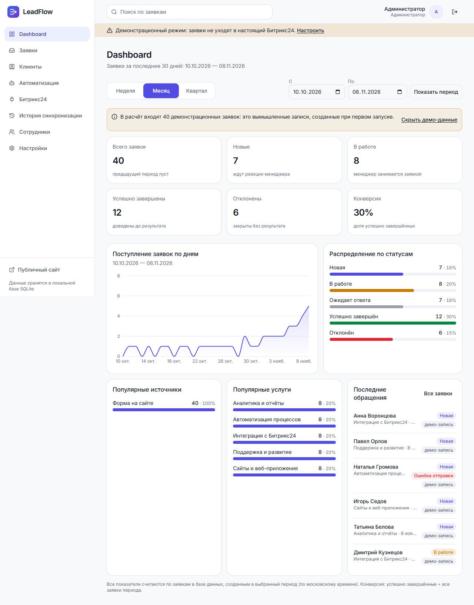
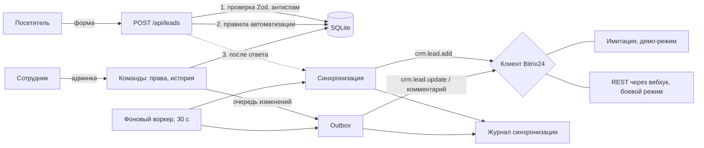

# LeadFlow

**LeadFlow** принимает заявки с сайта, сохраняет их в собственной базе, раздаёт менеджерам по правилам и передаёт в CRM **Битрикс24** через REST API. Ничего не теряется: если портал недоступен, заявка остаётся в системе и отправляется повторно, а каждое обращение к Битрикс24 записано в журнал.



> **Статус проекта: рабочий прототип для демонстрации.** Приём заявок, админка, роли, автоматизация, очередь отправки и аналитика реализованы и покрыты тестами. Интеграция с настоящим Битрикс24 написана по документации REST API, но **ни разу не запускалась против живого портала**: проверена только на тестах с подставным HTTP-ответом. Подробности в разделе [«Что реально, а что имитация»](#что-реально-а-что-имитация).

## Содержание

- [Что реально, а что имитация](#что-реально-а-что-имитация)
- [Возможности](#возможности)
- [Технологии](#технологии)
- [Архитектура](#архитектура)
- [Структура папок](#структура-папок)
- [Быстрый старт](#быстрый-старт)
- [База данных](#база-данных)
- [Переменные окружения](#переменные-окружения)
- [Подключение Битрикс24](#подключение-битрикс24)
- [Тесты](#тесты)
- [Развёртывание](#развёртывание)
- [Безопасность](#безопасность)
- [Ограничения и планы](#ограничения-и-планы)

Демонстрация для заказчика: [docs/DEMO.md](docs/DEMO.md).

## Что реально, а что имитация

| Часть | Статус |
|---|---|
| Форма на сайте, проверка данных, защита от спама и дублей | **Работает по-настоящему**, покрыто тестами |
| Хранение заявок, комментариев, истории, журнала (SQLite) | **Работает по-настоящему** |
| Вход, роли «администратор» и «менеджер», права на заявки | **Работает по-настоящему** |
| Правила автоматического назначения ответственного | **Работает по-настоящему** |
| Очередь отправки и повторы при сбоях | **Работает по-настоящему** (логика проверена тестами на имитации портала) |
| Dashboard и аналитика | **Работает по-настоящему**: цифры считаются по базе и сверяются тестом |
| Отправка в Битрикс24 в **демо-режиме** (по умолчанию) | **Имитация**: ответы выдуманы, наружу ничего не уходит. Везде помечена «демо» |
| Отправка в **настоящий** Битрикс24 (`BITRIX24_MODE=live`) | **Написана, но не проверена на живом портале** |
| Заявки и сотрудники из демо-набора | **Вымышленные** (адреса `@example.com`), помечены «демо-запись» |
| Публичный сайт | **Минимальная страница с формой.** Полноценный сайт (Главная, Услуги, О компании, Контакты) не реализован |

## Возможности

**Приём заявок**
- Форма на сайте: имя, телефон, email, услуга, комментарий. Проверка в браузере и на сервере (одна и та же схема Zod).
- Защита: скрытая ловушка для ботов, минимальное время заполнения, ограничение частоты (8 заявок за 10 минут с одного адреса), ключ повторной отправки: двойной клик не создаёт дубль.
- Заявка сначала сохраняется, потом отправляется в CRM: медленный или упавший портал не задерживает посетителя и не теряет заявку.

**Работа с лидами**
- Список: поиск по имени, телефону и email, фильтры по статусу, источнику, ответственному и дате, сортировка, страницы.
- Карточка: данные, пять статусов (новая, в работе, ожидает ответа, успешно завершена, отклонена), ответственный, комментарии, история изменений.
- Создание заявки вручную (для звонков и встреч).
- Права: менеджер меняет только свои и ещё не назначенные заявки, администратор любые.

**Автоматизация**
- Правила «по услуге» и «по кругу»: включаются и выключаются, применяются только после успешного сохранения заявки, каждое срабатывание пишется в историю.

**Интеграция с Битрикс24**
- Создание лида (`crm.lead.add`) с защитой от дублей: перед созданием ищется лид с тем же `ORIGIN_ID`.
- Смена статуса и ответственного (`crm.lead.update`), комментарии (`crm.timeline.comment.add`) идут через очередь с повторами.
- Журнал синхронизации: тип операции, заявка, ID в Битрикс24, статус, ошибка, число попыток, фильтры и страница подробностей. Секреты маскируются.
- Переключатель «Демо / Боевой», проверка подключения, инструкция в самом интерфейсе.

**Аналитика**
- Всего, новые, в работе, успешно завершены, отклонены, конверсия, график по дням, распределение по статусам, источники, услуги.
- Период: неделя, месяц, квартал или произвольный. Демо-данные помечены и скрываются одной ссылкой.

## Технологии

Next.js 16 (App Router, Cache Components) · React 19 · TypeScript · Tailwind CSS 4 · shadcn/ui (Base UI) · Recharts · Zod · SQLite (встроенный `node:sqlite`) · Playwright · tsx (unit-тесты на `node:test`).

Внешних сервисов и баз данных не нужно: приложение работает как один Node.js-процесс с файлом базы.

## Архитектура



Ключевые решения:

- **Слой интеграции изолирован.** Интерфейс `BitrixClient` (`src/features/bitrix/client.ts`) имеет две реализации: имитацию и REST-клиент. Логика синхронизации, мэппинг полей и повторы тестируются без сети.
- **Заявка не теряется.** Сохранение и отправка разделены. Состояния отправки: ожидает, отправляется, отправлено, ошибка. «Отправлено» ставится только после подтверждения: ID лида вернул портал (или имитация, и тогда запись помечена «демо»).
- **Без дублей.** Ключ повторной отправки на форме; атомарный захват заявки перед отправкой (параллельные повторы не отправят её дважды); поиск лида по `ORIGIN_ID` перед созданием.
- **Изменения не блокируют работу.** Статус, ответственный и комментарии сначала сохраняются локально и в истории, а затем попадают в очередь `outbox`. Сбой портала виден в карточке, но работу не останавливает.
- **Повторы по типу ошибки.** Временные сбои (таймаут, лимит запросов, 5xx) повторяются с нарастающей паузой (1 мин, 5 мин, 15 мин, 1 ч, 3 ч, до 6 попыток). Ошибки, которые чинит человек (права, неверный вебхук), автоматически не повторяются. Комментарий после неоднозначного таймаута тоже не повторяется сам, чтобы не получить дубль.
- **Демо не маскируется под реальность.** Всё, что произошло в имитации, хранится с признаком `demo` и помечено в списках, карточках и журнале. Изменения для лида с демо-ID никогда не отправляются на настоящий портал.
- **Права проверяются на сервере**: в прокси, на каждой странице и в каждом действии, а не только скрытием кнопок.

## Структура папок

```
leadflow/
├── src/
│   ├── app/                    страницы и API (Next.js App Router)
│   │   ├── page.tsx            публичная страница с формой
│   │   ├── login/              вход
│   │   ├── admin/              панель: dashboard, leads, clients, automation,
│   │   │                       integration, sync-log, staff, settings
│   │   └── api/                leads, health, bitrix/{status,check,call}, sync/run
│   ├── features/
│   │   ├── leads/              заявки: схемы, БД и миграции, команды, очередь,
│   │   │                       автоматизация, антиспам, фоновая отправка
│   │   ├── bitrix/             клиент Bitrix24: интерфейс, REST, имитация,
│   │   │                       мэппинг полей, синхронизация, маскирование секретов
│   │   ├── auth/               пароли (scrypt), сессии, права
│   │   ├── dashboard/          расчёт аналитики
│   │   └── clients/            клиенты как сводка по заявкам
│   ├── components/             ui (shadcn), shared, admin, site, layout
│   ├── data/demo.ts            вымышленные демо-данные
│   ├── lib/                    форматирование дат (московское время), утилиты
│   ├── proxy.ts                первый барьер для /admin (наличие сессии)
│   └── instrumentation.ts      запуск фонового воркера повторов
├── e2e/                        сценарии Playwright
├── scripts/                    demo.mjs, demo-reset.mjs, screenshots.mjs
├── docs/                       DEMO.md, скриншоты
├── Dockerfile, docker-compose.yml, .env.example
└── playwright.config.ts
```

Unit-тесты лежат рядом с кодом (`*.test.ts`).

## Быстрый старт

Нужен **Node.js 22.13 или новее** (встроенный `node:sqlite`; проект разрабатывался и проверялся на Node 26). Установка пакетов и запуск:

```bash
npm ci
npm run dev
```

Откройте http://localhost:3000. В режиме разработки учётные записи создаются автоматически (пароль для всех `leadflow-demo`), на странице входа они показаны:

| Почта | Роль |
|---|---|
| `admin@example.com` | администратор |
| `olga@example.com`, `denis@example.com`, `marina@example.com` | менеджеры |

База с вымышленными заявками создаётся в `data/leadflow.db` при первом запросе.

**Демо-стенд как в production** (рекомендуется для показа):

```bash
npm run build
npm run demo          # http://localhost:3000, база data/demo.db
npm run demo:reset    # вернуть демо-данные к исходным
```

Сценарий показа: [docs/DEMO.md](docs/DEMO.md).

## База данных

Используется **SQLite** (файл), встроенный в Node.js. Отдельной СУБД, Supabase или других сервисов нет.

- **Расположение:** `LEADFLOW_DB_PATH` (по умолчанию `data/leadflow.db`). Папка `data/` исключена из Git.
- **Создание и миграции:** автоматически при первом обращении к базе. Миграции лежат в `src/features/leads/migrations.ts`, применяются по порядку, каждая в своей транзакции, и записываются в таблицу `schema_migrations`. Повторный запуск безопасен, существующую базу прошлой версии они обновляют, не теряя данных.

| № | Что делает |
|---|---|
| 1 | заявки, журнал синхронизации, настройки |
| 2 | сотрудники, история заявки, очередь отправки, правила и журнал автоматизации; пять статусов; индекс поиска |
| 3 | признак демо-данных для аналитики |

- **Таблицы:** `leads`, `sync_events` (журнал), `settings`, `staff`, `lead_timeline` (история и комментарии), `outbox` (очередь изменений для Битрикс24), `automation_rules`, `automation_log`, `schema_migrations`.
- **Демо-данные:** 40 вымышленных заявок за последний месяц, журнал к ним и, при заданном пароле демо-менеджеров, три сотрудника и два правила. Вся демо-запись помечена и **не создаётся при обычном запуске в production** (только при `LEADFLOW_DEMO=true`).
- **Сброс:** остановите сервер и удалите файл базы (и `-wal`, `-shm` рядом) или выполните `npm run demo:reset` для демо-базы.
- **Резервная копия:** база работает в режиме WAL, поэтому копируйте сразу три файла (`.db`, `.db-wal`, `.db-shm`) при остановленном сервере либо используйте `sqlite3 data/leadflow.db ".backup копия.db"`.

## Переменные окружения

Полный комментированный список: [.env.example](.env.example). Скопируйте его в `.env.local` для разработки.

| Переменная | Нужна | Назначение |
|---|---|---|
| `LEADFLOW_SESSION_SECRET` | в production **обязательно** | Подпись cookie сессии, от 16 символов. Без неё войти нельзя |
| `LEADFLOW_ADMIN_PASSWORD` | в production **обязательно** | Пароль первого администратора `admin@example.com`. Применяется только при создании базы |
| `LEADFLOW_DB_PATH` | нет | Путь к файлу базы, по умолчанию `data/leadflow.db` |
| `BITRIX24_MODE` | нет | `demo` (по умолчанию) или `live`. Любое другое значение означает `demo` |
| `BITRIX24_WEBHOOK_URL` | для `live` | Входящий вебхук портала. Секрет |
| `LEADFLOW_API_TOKEN` | для `live` | Bearer-токен для `/api/bitrix/*` и `/api/sync/run` |
| `LEADFLOW_DEMO` | нет | `true`: заполнить пустую базу вымышленными заявками |
| `LEADFLOW_DEMO_PASSWORD` | нет | Пароль демо-менеджеров (создаются только с ним) |
| `LEADFLOW_SHOW_DEMO_LOGINS` | нет | `true`: страница входа показывает демо-аккаунты и пароль. Только для публичного демо-стенда |

Настоящие значения не должны попадать в Git: `.env*` исключены, кроме `.env.example`.

## Подключение Битрикс24

1. В Битрикс24: **Разработчикам → Другое → Входящий вебхук**. Выдайте право **CRM**. Лучше создать отдельного пользователя-интегратора.
2. Скопируйте адрес вида `https://портал.bitrix24.ru/rest/1/код/` (без имени метода в конце).
3. Задайте переменные и перезапустите сервер:
   ```
   BITRIX24_WEBHOOK_URL=https://портал.bitrix24.ru/rest/1/код/
   BITRIX24_MODE=live
   LEADFLOW_API_TOKEN=<длинная случайная строка>
   ```
4. В админке: **Битрикс24 → «Проверить соединение»**. Покажет портал, пользователя вебхука и его права; ошибка прав или адреса объясняется текстом и кодом.
5. Включите боевой режим переключателем (или `BITRIX24_MODE=live`).
6. В **Настройках** при необходимости поправьте соответствие статусов вашей воронке (по умолчанию стандартная воронка лидов: `NEW`, `IN_PROCESS`, `PROCESSED`, `CONVERTED`, `JUNK`) и ID ответственного по умолчанию.
7. В разделе **Сотрудники** укажите каждому ID пользователя в Битрикс24: иначе смена ответственного не дойдёт до CRM, и очередь покажет понятную ошибку.

Что важно знать:
- **Заявки из демо-режима** остаются «демо»: в боевом режиме их можно отправить в портал вручную кнопкой в карточке.
- **Дата создания** не передаётся отдельным полем (Битрикс24 её не принимает): она идёт текстом в комментарии лида.
- **Контакты** не создаются: лид несёт имя, телефон и почту, а контакт появляется при конвертации лида на стороне CRM.
- Обратной синхронизации (из Битрикс24 в LeadFlow) нет.
- Ответы реального портала не проверялись: ожидаемые форматы взяты из документации `crm.lead.add`, `crm.lead.list`, `crm.lead.update`, `crm.timeline.comment.add`, `profile`, `server.time`, `scope`. Первое подключение нужно проверить на тестовом портале.

## Тесты

```bash
npm test              # unit-тесты (node:test через tsx)
npm run lint          # ESLint
npm run typecheck     # TypeScript
npm run e2e           # production-сборка + все сценарии Playwright
npm run e2e:only      # то же без пересборки
npm run e2e:report    # HTML-отчёт последнего прогона
npm run verify        # всё перечисленное подряд
```

- **Unit-тесты:** схемы и нормализация, REST-клиент Bitrix24 (с подставным `fetch`), синхронизация и повторы, защита от дублей, очередь, автоматизация, права, миграции, аналитика, журнал, маскирование секретов.
- **Playwright** запускает собственный production-сервер на отдельной базе и использует установленный на машине **Google Chrome** (браузеры не скачиваются). Покрыто: публичный сайт и форма, API и защита от злоупотреблений, заявки и карточка, журнал, Dashboard, вход и роли, утечки секретов, боевой режим с недоступным порталом, чистая установка без демо-данных, адаптивность (360, 768, 1024, 1440 px) и мобильный профиль.
- Не покрыто тестами: настоящий Битрикс24, браузеры кроме Chrome, фоновый воркер повторов в браузерных сценариях (проверен unit-тестами).

## Развёртывание

LeadFlow хранит данные в **файле на диске** и запускает **фоновый процесс** повторной отправки. Поэтому ему нужен **постоянно работающий Node.js-сервер с постоянным диском**: виртуальный сервер, выделенный хост или контейнер с томом.

### Сервер с Node.js (проверенный путь)

```bash
npm ci
npm run build
LEADFLOW_SESSION_SECRET=... LEADFLOW_ADMIN_PASSWORD=... LEADFLOW_DB_PATH=/var/lib/leadflow/leadflow.db npm start
```

- Запускайте под менеджером процессов (systemd, pm2) и поставьте перед приложением обратный прокси с **HTTPS** (nginx, Caddy). Приложение определяет адрес клиента по заголовку `X-Forwarded-For`, поэтому прокси должен его **перезаписывать**, а не пропускать как есть.
- Проверка живости: `GET /api/health` отвечает `{"ok":true}` или 503.
- Запускайте один экземпляр: лимиты частоты хранятся в памяти процесса, а SQLite рассчитан на одного писателя.
- Для внешнего планировщика есть `POST /api/sync/run` (с Bearer-токеном в боевом режиме) на случай, если встроенный воркер недоступен.

### Docker

В репозитории есть `Dockerfile` и `docker-compose.yml` (образ на Node 24, том `/data` для базы, проверка `/api/health`). **Они не проверялись**: в среде, где писались, Docker не был установлен. Соберите образ и проверьте вход и перезапуск контейнера с сохранением данных до использования.

### Vercel и Supabase: сейчас не поддерживаются

Проект **не использует Supabase** и **не рассчитан на Vercel** в текущем виде, поэтому развёртывание туда не готовилось. Причины:

- база это локальный файл SQLite, а файловая система serverless-функций временная и недоступна для постоянной записи;
- повторную отправку выполняет фоновый таймер внутри процесса, в serverless он не живёт;
- ограничение частоты хранится в памяти процесса.

Чтобы перейти на Vercel + Supabase, понадобится: слой доступа к данным на Postgres вместо `node:sqlite` (весь SQL сосредоточен в `src/features/leads/repo*.ts`, `db.ts` и `migrations.ts`), перенос миграций, внешнее хранилище для лимитов частоты и запуск `/api/sync/run` по расписанию (Vercel Cron). Это отдельная работа, не выполненная в этой версии.

## Безопасность

Сделано и проверено тестами:
- Пароли хранятся как scrypt-хеш с солью; сессия подписана HMAC, живёт 8 часов, cookie `HttpOnly`, `Secure` в production, `SameSite=Lax`. Роль берётся из базы при каждом запросе, отключённый сотрудник теряет доступ сразу.
- Права проверяются в прокси, на страницах и в каждом серверном действии; подделанный или изменённый токен отклоняется; редирект после входа не может покинуть админку; перебор паролей ограничен.
- Адрес вебхука читается только на сервере и не попадает в браузер, бандлы и ответы API; текст ошибок, журнал и очередь очищаются от секретов.
- API `/api/bitrix/*` и `/api/sync/run` закрыты Bearer-токеном в боевом режиме; произвольный вызов REST ограничен списком методов только для чтения.
- Заголовки `X-Content-Type-Options`, `X-Frame-Options: DENY`, `Referrer-Policy`, `Permissions-Policy`; страницы под входом не кешируются общими кешами.

Не сделано (учитывайте перед публикацией в интернет):
- Нет Content-Security-Policy, CSRF-токенов сверх встроенной защиты Next.js для серверных действий, двухфакторного входа, сброса пароля и смены пароля из интерфейса.
- Ограничения частоты работают в памяти одного процесса и привязаны к `X-Forwarded-For`.
- Журнал аудита покрывает заявки и интеграцию, но не действия администратора над сотрудниками и настройками.

## Ограничения и планы

Известные ограничения:
- Публичный сайт минимален (одна страница с формой).
- Только московское время во всех датах.
- Один экземпляр сервера; нет Postgres; Docker-файлы не проверены.
- Источников заявок два (сайт, вручную); утм-метки и каналы не учитываются.
- Правила автоматизации нельзя редактировать и переупорядочивать (создание, включение, удаление).
- Нет обратной синхронизации из Битрикс24 и OAuth (только входящий вебхук).
- Аналитика загружает заявки периода в память: для десятков тысяч заявок нужен SQL-расчёт.

Что можно улучшить дальше: полноценный публичный сайт; Postgres и развёртывание на Vercel/Supabase; обратная синхронизация событиями Битрикс24; редактирование правил и условия по источникам; уведомления менеджерам (почта, Telegram); смена и сброс пароля; CSP и аудит действий администратора; проверка на живом портале и в Firefox/Safari.

## Лицензия

Лицензия не выбрана. Прежде чем открывать репозиторий, добавьте файл `LICENSE` (например, MIT) или оставьте права за собой.
